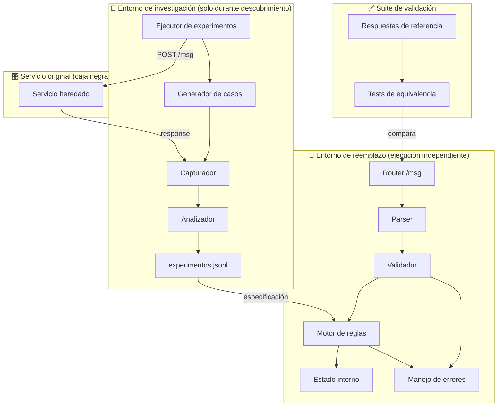

# Arquitectura — Black Box

> Estado: **Propuesto**

## 1. Diagrama de arquitectura



## 2. Separación de entornos

La línea punteada entre "Investigación" y "Reemplazo" es una barrera de contención arquitectónica. El reemplazo desplegado:

- **No tiene** acceso de red al servicio original.
- **No tiene** código de fuzzing, captura ni análisis.
- **Solo tiene** las reglas derivadas de la especificación.

## 3. Contrato de interfaces internas

### Parser → Validador

```
Input:  mensaje crudo (string)
Output: comando estructurado o error de parseo
```

### Validador → Motor

```
Input:  comando estructurado
Output: comando validado o error de validación
```

### Motor → Estado

```
Input:  comando validado + token
Output: nuevo estado (mutación) + resultado de ejecución
```

## 4. Independencia del servicio original

El reemplazo debe poder iniciarse y responder correctamente en un entorno sin conectividad a `caja-negra-production-c64f.up.railway.app`. Cualquier dependencia de red se considera un defecto de arquitectura.

## 5. Escalabilidad de evaluación

- Cada test comienza con `POST /__reset`.
- El servicio evaluador habla a un único proceso.
- Estado en memoria es suficiente porque no hay persistencia requerida entre tests.
