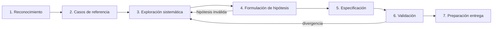

# Estrategia de ingeniería inversa — Black Box

## Filosofía

No adivinamos qué quería decir el desarrollador original. Documentamos **exactamente** qué observamos.

---

## Fases

### Fase 1. Reconocimiento

- Revisar material oficial (README, ejemplos, reglas).
- Identificar cómo ejecutar el servicio original.
- Determinar protocolo y mecanismo de comunicación.
- Establecer entorno reproducible (scripts, token, reset).

### Fase 2. Casos de referencia

- Reproducir los 20 ejemplos proporcionados exactamente.
- Registrar respuestas completas: status, headers, body, latencia.
- Repetir para confirmar determinismo.
- Establecer línea base contra la que comparar.

### Fase 3. Exploración sistemática

- Variar **un parámetro a la vez**.
- Probar: valores vacíos, límites, tipos inesperados, malformaciones.
- Desarrollar scripts de fuzzing propios.
- Enfocarse en: dígito de control, aridad, límites numéricos, case sensitivity.

### Fase 4. Formulación de hipótesis

- Documentar patrones observados.
- Diseñar experimentos que **distingan** entre hipótesis competidoras.
- Ejemplo: si sospechamos suma ponderada para el control, probar un caso que falle la suma simple pero pase la ponderada.

### Fase 5. Especificación

- Traducir hallazgos en reglas verificables.
- Identificar ambigüedades.
- Cada regula vinculada a línea de `experimentos.jsonl`.

### Fase 6. Validación

- Comparar reemplazo vs referencias.
- Corregir divergencias byte a byte.
- Ejecutar pruebas de regresión tras cada cambio.

### Fase 7. Preparación para entrega

- Verificar independencia del original (no requests salientes).
- Verificar despliegue accesible.
- Confirmar formatos de entregables contra README oficial.

---

## Diagrama de flujo de fases

## Reglas de oro

1. **Un cambio por experimento.** Si mutás dos cosas y falla, no sabés cuál causó el cambio.
2. **Reset antes de cada secuencia.** El estado es enemigo de la reproducibilidad.
3. **Loguear todo.** Un experimento no logueado es un experimento no hecho.
4. **No generalizar de N=1.** Repetí al menos 3 veces.
5. **Ruido vs señal.** Diferencias de timestamps = ruido. Diferencias de saldo = señal.
